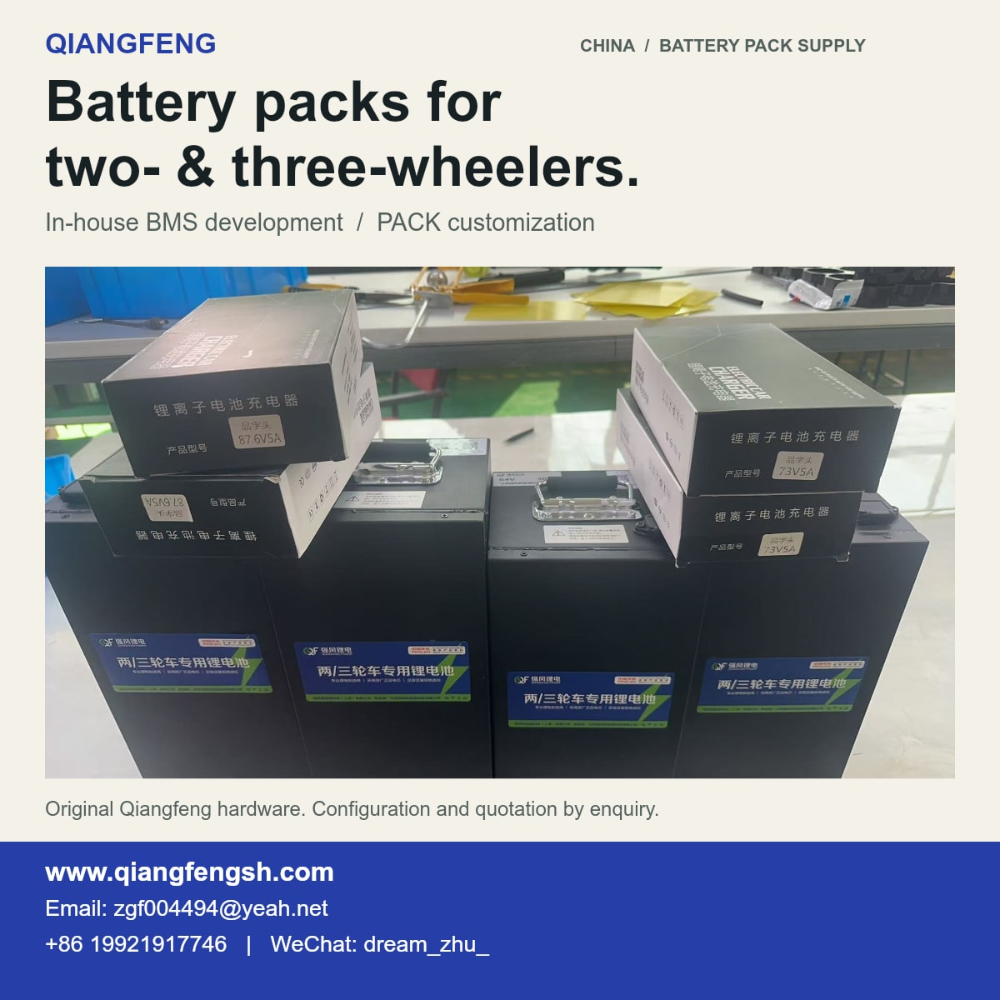
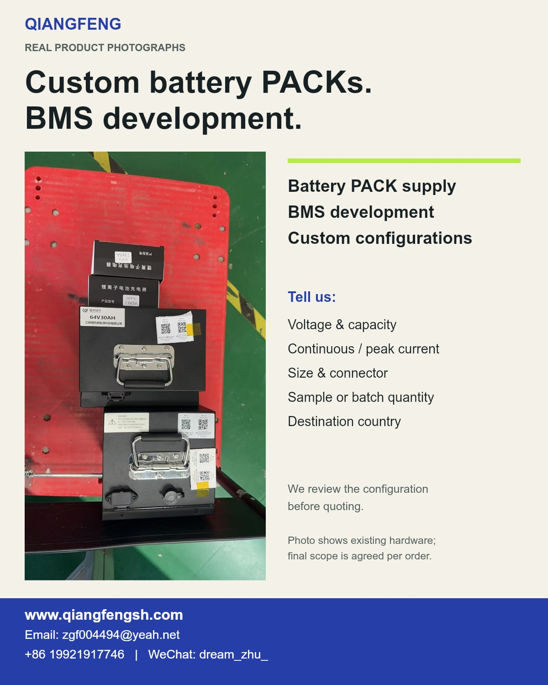

# Two- and three-wheeler lithium battery PACK supply and BMS development

**Qiangfeng New Energy Technology (Shanghai) Co., Ltd. · China**  
**强风新能源科技（上海）有限公司｜两轮车锂电池BMS与PACK项目**

## Actual battery PACK photographs / 两三轮车电池实拍

**Need complete battery packs, a BMS, or a custom configuration?** Qiangfeng supplies lithium battery PACKs and develops BMS solutions for project matching. The photographs show actual Qiangfeng-branded metal-housing packs and charger packages; the product bodies, labels and nameplates have not been redrawn.

Tell us the vehicle type, target voltage and capacity, installation space, connector, quantity and destination. We compare an available configuration first and identify any BMS, enclosure or wiring work separately. This helps buyers assess the required scope and budget before requesting a quotation.

**Email:** [zgf004494@yeah.net](mailto:zgf004494@yeah.net?subject=Two-%20or%20three-wheeler%20battery%20PACK%20enquiry) · **Phone:** +86 19921917746 · **WeChat:** dream_zhu_

The visible nameplate belongs to the photographed pack, not to every product in this catalogue. Cell chemistry, operating voltage range, current, dimensions, charger, supplied parts, lead time and delivery are confirmed for the selected model and order. Prices are on request; no universal shipping or certification claim is made.

这批照片为强风两／三轮车电池原始实拍，仅在照片外增加英文说明。可沟通整包供货、自研BMS和PACK定制，按用途、预算与数量选型；具体型号、电芯、保护参数、接插件、充电器及交期在报价中确认。

[**View product photographs and supply options / 查看产品实拍与供货范围**](https://qiangfeng-battery-bms.zgf004494.chatgpt.site/two-wheeler-bms)

Building an e-bike or e-scooter battery pack? Talk to Qiangfeng about BMS boards, firmware integration and complete PACK development. We work with pack builders and equipment teams to match the board, protection functions, communication and assembly scope to the application and target cost.

[**Email our product team — start a BMS enquiry**](mailto:zgf004494@yeah.net?subject=Two-wheeler%20BMS%20supplier%20enquiry&body=Application%20%2F%20vehicle%20type%3A%0AWhat%20we%20need%20help%20with%3A%0AQuantity%20(if%20known)%3A%0ACountry%20%2F%20city%3A%0AReply%20contact%3A%0A%0ASource%20page%3A%20https%3A%2F%2Fgithub.com%2Fzgf456654321%2Fqiangfeng-battery-bms-catalog%2Fblob%2Fmain%2Ftwo-wheeler-bms-enquiry.md)  
**Phone:** +86 19921917746 · **WeChat:** dream_zhu_

The email link opens your email app with a short project brief. Add what you know, then send it yourself. You can also contact us by phone or WeChat.

[Optional: use the online enquiry form](https://docs.google.com/forms/d/e/1FAIpQLSdx-mG3j-H6vrwYWqhMdXxItm-YVLeJKHv8Wl00nBteDbP6xw/viewform?usp=pp_url&entry.1964661460=Two-wheeler%20BMS%20%2F%20battery%20PACK%20project%20%7C%20%E4%B8%A4%E8%BD%AE%E8%BD%A6BMS%E4%B8%8E%E7%94%B5%E6%B1%A0PACK%20%E2%80%94%20add%20quantity%20or%20write%20selection%20needed)

Start with what you need help with, your country and a reply contact. If you have not chosen the voltage, current or interface yet, write **“selection needed”**.

## Choose the work you need

| Your project | What we discuss |
|---|---|
| You assemble packs and need a BMS | Cell chemistry and series count, load profile, protection settings, wiring, connectors and the suitable board version |
| Your pack needs communication | Host data requirements, CAN / RS485 or another requested interface, firmware scope and a joint test plan |
| You need a complete battery PACK | Cells, BMS, enclosure, wiring, charger matching, assembly and the agreed prototype or production scope |
| You want to improve the cost of an existing design | Check available designs first, identify essential functions and quote any customization separately |

A board is selected for a defined pack and controller interface. Share the requirements you can disclose; a non-confidential interface brief is enough to start the discussion.

## See existing Qiangfeng hardware

Existing hardware reference from Qiangfeng product materials. The photograph does not specify a ready-to-install two-wheeler model; the selected board, current rating and interfaces are confirmed for the project.

[View original BMS hardware and project details](https://www.qiangfengsh.com/custom-bms-shanghai.html#hardware)

## From first enquiry to a sample

1. **Tell us the application.** Pack builders can start with the vehicle type, desired supply scope and the issue they want to solve.
2. **Review the configuration.** We check an available design first, then define any board, firmware, wiring or PACK changes.
3. **Agree the quotation and sample test.** Confirm the supplied parts, price, quantity, lead time, acceptance checks and delivery arrangements.

Prices are available on request. We confirm model-specific specifications and commercial terms before accepting an order.

## 两轮车电池厂家、PACK组装企业怎么对接

强风提供自研BMS与锂电池PACK项目对接。已有板型先匹配，确需调整的接口、保护参数、固件和结构再评估，按预算核对功能与供货清单。

- **采购BMS板卡**：告诉我们用途、电芯体系、串数、负载及所需通信；未定参数可写“待选型”。
- **整包开发或配套**：说明需要电芯、BMS、壳体、线束还是完整PACK，先确定合作范围。
- **先沟通、再报价**：初次联系不用填完整技术问卷，详细参数随选型逐步核对。

[**邮件发送两轮车BMS / PACK需求**](mailto:zgf004494@yeah.net?subject=Two-wheeler%20BMS%20supplier%20enquiry&body=Application%20%2F%20vehicle%20type%3A%0AWhat%20we%20need%20help%20with%3A%0AQuantity%20(if%20known)%3A%0ACountry%20%2F%20city%3A%0AReply%20contact%3A%0A%0ASource%20page%3A%20https%3A%2F%2Fgithub.com%2Fzgf456654321%2Fqiangfeng-battery-bms-catalog%2Fblob%2Fmain%2Ftwo-wheeler-bms-enquiry.md)  
电话：19921917746 · 微信：dream_zhu_

[备选：在线询价表](https://docs.google.com/forms/d/e/1FAIpQLSdx-mG3j-H6vrwYWqhMdXxItm-YVLeJKHv8Wl00nBteDbP6xw/viewform?usp=pp_url&entry.1964661460=Two-wheeler%20BMS%20%2F%20battery%20PACK%20project%20%7C%20%E4%B8%A4%E8%BD%AE%E8%BD%A6BMS%E4%B8%8E%E7%94%B5%E6%B1%A0PACK%20%E2%80%94%20add%20quantity%20or%20write%20selection%20needed)

## Direct company contact

- **Business email:** [zgf004494@yeah.net](mailto:zgf004494@yeah.net)
- **Phone:** +86 19921917746
- **WeChat:** dream_zhu_
- **Company website:** https://www.qiangfengsh.com/
- **English BMS and PACK enquiries:** https://www.qiangfengsh.com/custom-bms-shanghai.html#enquiry

Shanghai coordinates development and project discussions; battery production is coordinated with our Jiangxi factory. Dispatch location and delivery terms are confirmed for the selected supply scope.

[Back to the Qiangfeng product catalogue](README.md)

Updated: 27 October 2026.
